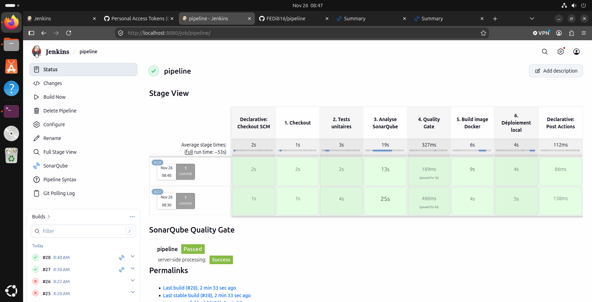
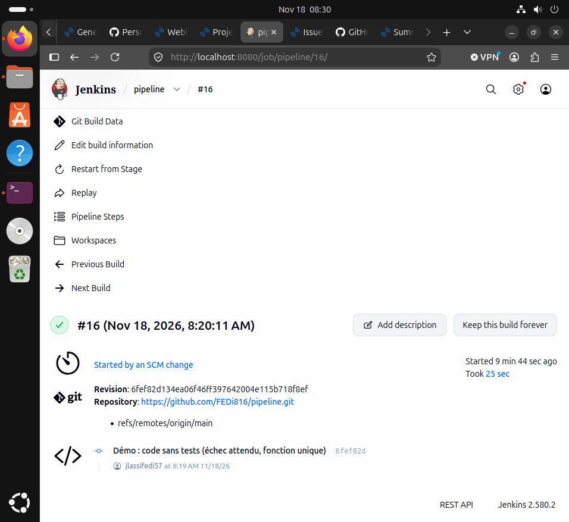
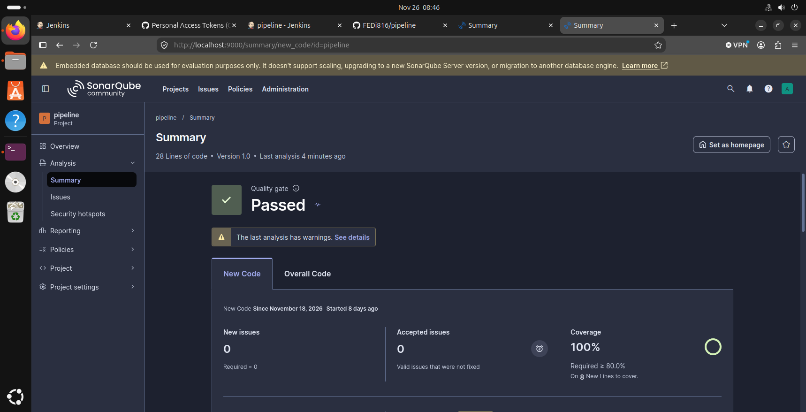
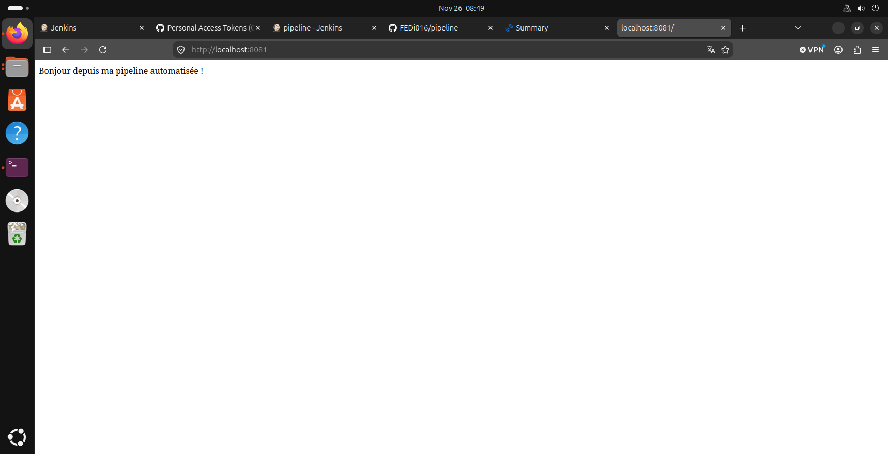

# Pipeline de contrôle qualité automatisé

Projet de TP : chaque modification envoyée sur GitHub déclenche une pipeline Jenkins. Le code est testé, analysé par SonarQube, puis déployé dans un conteneur Docker seulement si la quality gate est respectée. Si la gate échoue, la pipeline s'arrête et rien n'est déployé.

## Architecture

## Technologies

| Outil | Rôle |
|---|---|
| GitHub | Hébergement du code source |
| Jenkins | Orchestration de la pipeline (Jenkinsfile) |
| pytest / pytest-cov | Tests unitaires et mesure de la couverture |
| SonarQube | Analyse de la qualité, de la sécurité et de la couverture |
| Docker | Construction de l'image et déploiement local |
| Flask / Gunicorn | Application web et serveur de production |

## Structure du projet


## Étapes de la pipeline

| Étape | Description | Si échec |
|---|---|---|
| 1. Checkout | Récupération du code depuis GitHub | Pipeline arrêtée |
| 2. Tests unitaires | Exécution de pytest et rapport de couverture | Pipeline arrêtée |
| 3. Analyse SonarQube | Envoi du code et de la couverture à SonarQube | Pipeline arrêtée |
| 4. Quality Gate | Attente du verdict de SonarQube | Pipeline arrêtée, rien n'est déployé |
| 5. Build image Docker | Construction de l'image `pipeline:<numéro>` | Pipeline arrêtée |
| 6. Déploiement local | Remplacement du conteneur sur le port 8081 | Pipeline arrêtée |

## Règles de la quality gate

Sur le nouveau code :
- Bugs : aucun
- Vulnérabilités : aucune
- Duplication : inférieure à 3 %
- Couverture : au moins 80 %

## Déclenchement automatique

Jenkins interroge GitHub toutes les deux minutes (`pollSCM`). Quand un nouveau commit est détecté, il lance le build seul, avec la mention « Started by an SCM change ».

## Lancer le projet

Tests en local :

```bash
python3 -m venv venv
. venv/bin/activate
pip install -r requirements.txt
python -m pytest -v
```

Application avec Docker :

```bash
docker build -t pipeline .
docker run -d -p 8081:8080 pipeline
curl http://localhost:8081/
```

## Endpoints de l'application

| Route | Réponse |
|---|---|
| `/` | Message d'accueil |
| `/add/<a>/<b>` | Somme de deux entiers, au format JSON |
| `/version` | Numéro de version de l'application |

## Limites de l'environnement

- Le webhook SonarQube vers Jenkins fonctionne avec la validation désactivée (`sonar.validateWebhooks=false`) : à ne pas reproduire en production.
- Le déploiement est local (port 8081), pas sur un serveur distant.
- Le faux positif CSRF signalé par SonarQube a été marqué manuellement, avec justification.

## Captures

### Stage View de Jenkins (build réussi)


### Quality gate bloquante (build en échec)


### Dashboard SonarQube


### Application en route

